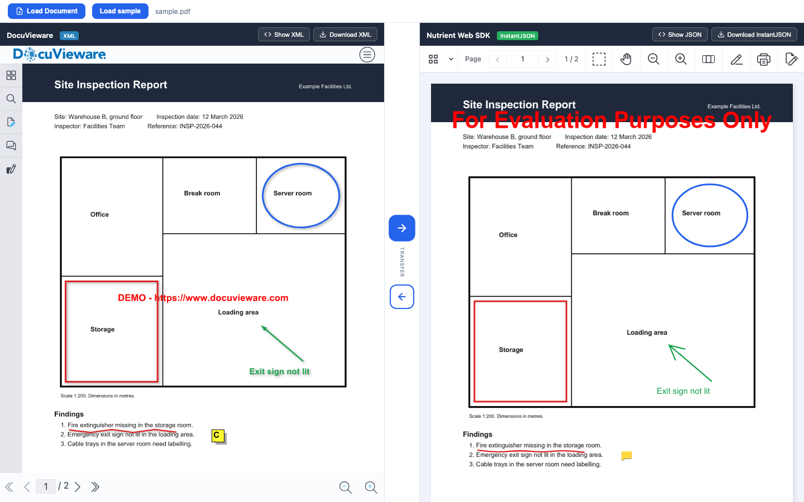
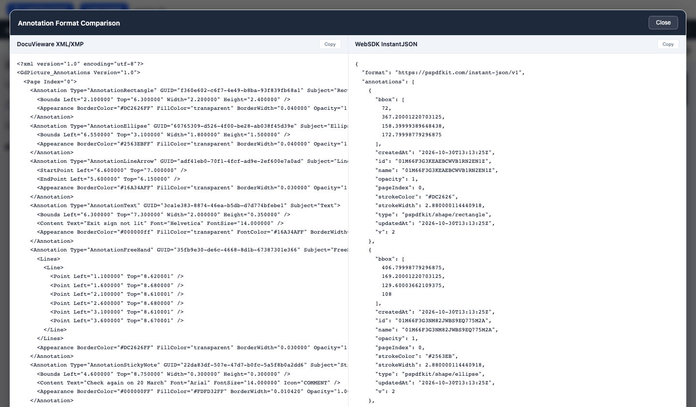

# Nutrient Annotation Converter

# DICLAIMER: This sample is outdated, we have now methods to do XML/XMP <> InstantJSON annotations conversion.

A Nutrient.io demo that converts annotations in both directions between the GdPicture/DocuVieware XML format and Nutrient Web SDK Instant JSON, with both viewers side by side on the same PDF.



*Screenshots are taken in evaluation mode, so both viewers show a demo mark.*

1. **Two viewers.** One page shows DocuVieware on the left (rendered by the ASP.NET Core server, .NET 10) and Nutrient Web SDK 1.7.0 on the right (in the browser, loaded from the Nutrient CDN).
2. **Load.** **Load sample** opens `wwwroot/sample.pdf` in both viewers. **Load Document** uploads your own PDF to `wwwroot/uploads` first.
3. **DocuVieware to Web SDK.** The `export-annotations` custom action reads the annotations with GdPicture `AnnotationManager` and returns XML: inches, boxes given by their centre, points in page coordinates. The browser turns the XML into Instant JSON (PDF points, 72 per inch, boxes given by their top-left corner) and creates the annotations in Web SDK.
4. **Web SDK to DocuVieware.** The browser exports Instant JSON from Web SDK, turns it into the same XML and sends it to the `clear-annotations` and `import-annotations` custom actions, which add the annotations with `AnnotationManager`.
5. **Compare.** **Show XML** or **Show JSON** opens both formats side by side. Each side can be downloaded.

## Supported annotations

| DocuVieware (XML type) | Web SDK (Instant JSON type) | Directions |
|---|---|---|
| `AnnotationRectangle` | `pspdfkit/shape/rectangle` | both |
| `AnnotationEllipse` | `pspdfkit/shape/ellipse` | both |
| `AnnotationLine`, `AnnotationLineArrow` | `pspdfkit/shape/line` (arrow as `lineCaps.end`) | both |
| `AnnotationPolygon` | `pspdfkit/shape/polygon` | both |
| `AnnotationConnectedLines` | `pspdfkit/shape/polyline` | both |
| `AnnotationFreeHand` | `pspdfkit/ink` | both |
| `AnnotationText` | `pspdfkit/text` | both |
| `AnnotationStickyNote` | `pspdfkit/note` | both |
| `AnnotationRubberStamp` | `pspdfkit/stamp` | both |
| `AnnotationRedaction` | `pspdfkit/redaction` | DocuVieware to Web SDK |
| Highlight, underline, strikeout, squiggly | `pspdfkit/markup/*` | DocuVieware to Web SDK |

Rectangle, ellipse, arrow, text, freehand and sticky note were checked in a full round trip (DocuVieware to Web SDK and back): positions, directions, colours and text come back unchanged.

Some properties have no exact match. DocuVieware sets a separate opacity on the fill and the stroke, while Web SDK has one opacity for the whole annotation, so a semi-transparent fill becomes opaque in Web SDK.

## Prerequisites

- .NET SDK 10
- Windows, macOS or Linux (DocuVieware.API is cross-platform)
- Internet access: the page loads jQuery from the Google CDN and Web SDK from the Nutrient CDN

## Environment variables

All variables are optional. Start from `.env.example`. License keys are only read from the environment, never from code.

| Variable | Purpose | Default |
|---|---|---|
| `DOCUVIEWARE_LICENSE_KEY` | DocuVieware license key; it also unlocks the GdPicture classes used by the custom actions | empty = evaluation mode |
| `NUTRIENT_WEB_LICENSE_KEY` | Nutrient Web SDK license key, served to the page by `GET /api/config` | empty = evaluation mode |
| `APP_URI` | Address the app listens on. DocuVieware also puts it into the control markup, so the browser must be able to reach it | `http://localhost:5050` |

In evaluation mode both viewers show a demo mark, and the DocuVieware process stops after one hour. Start it again, or set trial or commercial keys.

## Build and run

```bash
cp .env.example .env
```

```bash
cd AnnotationConverterApi
```

```bash
set -a && source ../.env && set +a && dotnet run
```

Open <http://localhost:5050>.

## Using the app

1. Click **Load sample**, or **Load Document** to pick your own PDF. The document opens in both viewers.
2. Draw annotations in DocuVieware (annotation tools in the left panel), then click the right arrow. They appear in Web SDK.
3. Draw or edit annotations in Web SDK, then click the left arrow. DocuVieware's annotations are replaced by the Web SDK ones.
4. Click **Show XML** or **Show JSON** to compare both formats, then **Copy**, or close the overlay and use **Download XML** and **Download InstantJSON**.

   

Example of one rectangle in both formats (2.2 by 2.4 inches, centred at 2.1 by 6.3 inches from the top-left corner of the page):

```xml
<Annotation Type="AnnotationRectangle" GUID="..." Subject="Rectangle">
  <Bounds Left="2.100000" Top="6.300000" Width="2.200000" Height="2.400000" />
  <Appearance BorderColor="#DC2626FF" FillColor="transparent" BorderWidth="0.040000" Opacity="1.000000" />
</Annotation>
```

```json
{ "type": "pspdfkit/shape/rectangle", "pageIndex": 0, "bbox": [72, 367.2, 158.4, 172.8], "strokeColor": "#DC2626", "strokeWidth": 2.88, "opacity": 1 }
```

## Sample document

`AnnotationConverterApi/wwwroot/sample.pdf` is a fictitious two-page site inspection report with a floor plan. It is generated by `samples/generate_samples.py`:

```bash
python3 -m venv .venv-samples
```

```bash
.venv-samples/bin/pip install reportlab
```

```bash
.venv-samples/bin/python samples/generate_samples.py
```

## API

| Method and path | Description |
|---|---|
| `POST /api/DocuVieware/GetDocuViewareControl` | Body: session ID, control ID, toolbar options and `Theme` (`light` or `dark`). Returns `{ htmlContent }`, the control markup |
| `POST /api/document/upload` | multipart `file` (PDF). Saves it in `wwwroot/uploads` and returns `{ url }` |
| `GET /api/config` | `{ webSdkLicenseKey }` for the page |
| `GET /health` | `{ status: "ok" }` |
| `api/docuvieware3/*` | Internal routes of the DocuVieware control |

Custom actions, called from the page with `DocuViewareAPI.PostCustomServerAction`:

| Action | Argument | Result |
|---|---|---|
| `export-annotations` | none | The annotations of the document as XML |
| `import-annotations` | XML | Adds the annotations to the document. Returns `{ success, imported }` |
| `clear-annotations` | none | Deletes every annotation. Returns `{ success }` |

## Project layout

| Path | Content |
|---|---|
| `AnnotationConverterApi/Startup.cs` | License, DocuVieware setup, `/api/config` |
| `AnnotationConverterApi/CustomActions/AnnotationConverterCustomActions.cs` | XML export and import with GdPicture `AnnotationManager` |
| `AnnotationConverterApi/Controllers` | Control markup, PDF upload and DocuVieware control routes |
| `AnnotationConverterApi/wwwroot/annotation-converter.js` | XML and Instant JSON conversion, both viewers, transfer buttons |
| `AnnotationConverterApi/wwwroot/index.html` | Page layout |
| `samples/generate_samples.py` | Sample generator |
